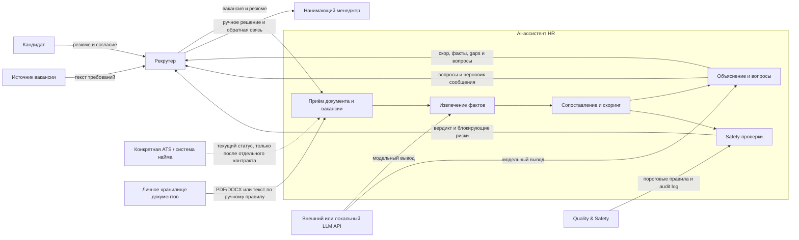

# Контекстная граница системы

## Назначение

Этот документ фиксирует границу автоматизированного первичного отбора кандидатов до того, как команда выбирает конкретный ATS или хранилище. Контекстная диаграмма описывает систему как единый проектируемый модуль, а не утверждает, что внешние системы уже реализованы.



## Система внутри границы

- Приём вакансии и резюме.
- Извлечение skills, опыта и фактов.
- Сопоставление фактов с must-have и nice-to-have.
- Расчёт скорового ранжирования.
- Формирование объяснения с источниками.
- Формирование черновых вопросов для интервью.
- Запуск fairness и prompt-injection проверок.
- Запись audit-событий без персональных данных.

Система не принимает оффер и не отправляет финальный отказ.

## Внешние акторы и системы

| Внешняя сущность | Связь с системой | Ввод или результат | Принадлежность границе |
|---|---|---|---|
| Рекрутер | Оператор первого энда | Загружает документы; подтверждает финальный приоритет | Вне системы, полностью управляет ручным решением |
| Нанимающий менеджер | Получатель согласованного shortlist | Согласует критерии и вопросы, не пишет статус автоматически | Вне системы |
| Кандидат | Источник данных и согласия | Передаёт резюме и получает общение от человека | Вне системы |
| Quality & Safety | Контролёр запуска | Метрики, пороги, audit-критерии и блокировка релиза | Вне системы, только интерфейс блокирующего результата |
| Источник вакансии | Внешний владелец требований | Текст вакансии и must-have | Вне системы |
| Личное хранилище документов | Канал передачи в MVP | PDF/DOCX или текст по ручному праву | Вне системы |
| Конкретная ATS | Потенциальный системный источник статуса | Нет двусторонней связи в MVP | Вне системы до отдельного решения |
| LLM provider | Внешняя вычислительная зависимость | Токены и JSON-контракт или локальный вариант | Вне системы |

## Спорный пограничный элемент: интеграция с ATS

### Где возникает спор

ATS-интеграция одновременно понимается как:

1. источниками и приёмником данных о статусе кандидата;
2. только источником резюме и вакансии без права менять статус;
3. способ передачи финального рейтинга рекрутеру;
4. ссылкой на систему найма как внешнюю доказательную инфраструктуру.

Эти трактовки создают разную границу ответственности. Первая даёт системе автоматический или двусторонний эффект на найма; вторая сохраняет ручное управление; третья делает систему пассивным отчётным модулем; четвёртая не указывает конкретный контракт данных.

### Решение для MVP

Интеграция с конкретной ATS не входит в MVP.

Вместо двустороннего соединения MVP принимает PDF/DOCX или текст вручную из согласованного хранилища. Рекрутер копирует данные о вакансии и резюме. Система не получает и не изменяет статус кандидата в ATS.

Внешняя связь допускается только через явный протокол версии 1:

```text
Вход: vacancy_id, vacancy_text, resume_content, consent_reference
Выход: score, must_have, nice_to_have, gaps, evidence, safety_flags
Запрет: update_candidate_status, send_rejection, create_offer
```

Текущий статус ATS не считается входом MVP. Любой будущий API-контракт требует отдельного решения с ответственностью за права записи, синхронизацию статуса и согласие кандидата.

### Критерий открытия границы

ATS-интеграция не добавляется только на основании того, что рекрутер просит удобство. Допуск требуется при выполнении всех условий:

- конкретная ATS и права API определены;
- владелец системы подтвердил режим и права записи;
- кандидаты или владелец данных дали соглашение на передачу;
- синхронизация статусов описана с идемпотентностью и отказами;
- отдельная проверка безопасности подтверждает отсутствие автоматического найма или отказа;
- три наблюдения в реальном процессе подтвердили повторяющуюся потребность в двустороннем статусе.

### Последствия решения

- За автоматическую запись отвечает только рекрутер или конкретная ATS-владельческая система.
- Ложная интеграция не считается реализованной ошибкой в MVP.
- Неиспользуемые данные и персональная информация остаются вне проекта до отдельного согласования.

## Другие спорные границы

- Статус кандидата — система предлагает приоритет, а не обновляет HR-статус.
- Роль нанимающего менеджера — согласует must-have и принимает решение, но не редактирует исходное резюме.
- Согласие кандидата — документ не передаётся системе без разрешения, источник хранится вне MVP.
- Модельный провайдер — считается внешним, но его ответ ограничен structured JSON и не считается персональным решением.
- Финальный отказ — человек подписывает сообщение вне системы; ассистент только формирует черновик.

Все спорные границы имеют один общий принцип: система не принимает право на человеческое решение или изменение канонического процесса найма без явного контракта и подтверждённых наблюдений.
