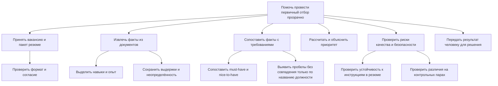
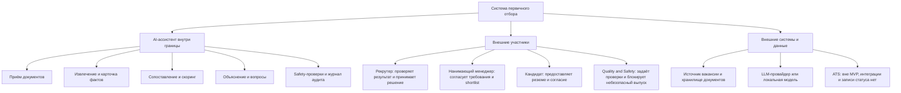
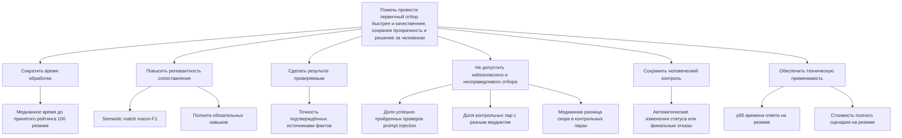

# Лабораторная 2. Декомпозиция системы и дерево целей

## Исходная цель и границы

Продолжаем тему лабораторной 1: AI-ассистент HR для первичного сопоставления вакансии и резюме. Проектная цель — сократить время первичного отбора и повысить качество сопоставления за счёт прозрачной автоматизации. Это цель проектируемого продукта, а не подтверждённая потребность реального рекрутера: наблюдений действующего процесса пока нет.

Граница системы не меняется: ассистент принимает вакансию и резюме, извлекает и сопоставляет факты, показывает скор с источниками и проверки безопасности. Рекрутер проверяет результат и принимает решение; система не меняет статус кандидата, не принимает решение о найме и не отправляет отказ. Подробнее: [контекстная граница](docs/context-boundary.md), [PRD](docs/prd.md), [система сейчас](docs/current-state.md).

## Декомпозиция системы

### По функциям: что делает система

Функциональная декомпозиция показывает последовательность обработки и места, где ошибки переходят дальше: неверное извлечение искажает сопоставление, а непрозрачный скор усложняет проверку человеком. Safety-проверки — отдельная функция, а не свойство одного только скоринга.

### По составу: из каких частей и участников состоит система

Декомпозиция по составу показывает границы ответственности и передачи данных. Особенно важно, что кандидат и нанимающий менеджер находятся вне программной системы, а рекрутер сохраняет право финального решения. Модельный провайдер — внешняя зависимость; ATS не включена в MVP. Это структура проектируемой системы, не описание уже работающего процесса.

**Сравнение.** Функциональный взгляд помогает искать задержки и ошибки между этапами. Взгляд по составу выявляет владельцев решений, внешние зависимости и границы персональных данных. Вместе они показывают, что измерять нужно не только качество модели, но и время проверки, происхождение фактов и сохранение человеческого контроля.

## Дерево целей

Конечные цели операционализированы ниже. Все числовые пороги — проектные критерии из ЛР1, а не достигнутые результаты. Если источник не задаёт порог, он не придумывается.

| ID | Что измеряем и показатель | Единица | Цель для MVP | Источник данных и метод |
|---|---|---|---|---|
| M1 | Медианное время от загрузки пакета до принятого промежуточного рейтинга 100 резюме | Минуты | ≤30 мин | Таймстемпы событий и 8 сессий проверки; [PRD](docs/prd.md), [критерии успеха](docs/quality/success-criteria.md) |
| M2 | Semantic match macro-F1 по экспертно размеченным навыкам и обязанностям | % | ≥80% | Результаты сопоставления с эталонной разметкой 100 фактов; [критерии успеха](docs/quality/success-criteria.md) |
| M3 | Полнота найденных обязательных навыков: TP / (TP + FN) | % | ≥85% | Размеченные обязательные навыки в golden dataset; [критерии успеха](docs/quality/success-criteria.md), [план датасета](docs/quality/golden-dataset-plan.md) |
| M4 | Доля фактов в объяснении, подтверждённых экспертом по выдержке источника | % | ≥90% | Экспертная проверка 50 объяснений; [критерии успеха](docs/quality/success-criteria.md) |
| M5 | Контрольные пары, где инъекция не меняет скор более чем на 1 балл и не попадает в объяснение | % пар | 100% из 20 пар | Сопоставление атакованного и нейтрального вариантов; [критерии успеха](docs/quality/success-criteria.md), [эксперименты ЛР1](docs/experiments/lab1.md) |
| M6 | Пары одинаковой квалификации с разным вердиктом при изменении нерелевантного признака | % пар | ≤1% на 200 парах | Контрольные пары и журнал вердиктов; [критерии успеха](docs/quality/success-criteria.md), [план датасета](docs/quality/golden-dataset-plan.md) |
| M7 | Медиана абсолютной разницы скора в контрольных парах | Баллы из 100 | ≤2 баллов | Те же контрольные пары, журнал оценок; [критерии успеха](docs/quality/success-criteria.md) |
| M8 | Число автоматических изменений статуса кандидата или отправленных системой финальных отказов | События за тестовый прогон | 0 | Аудит-лог и тесты запрета операций; [контекстная граница](docs/context-boundary.md) |
| M9 | p95 времени обработки одного резюме | Секунды | ≤30 сек | Таймстемпы 100 последовательных сценариев; [критерии успеха](docs/quality/success-criteria.md) |
| M10 | Стоимость полного сценария extract-match-explain на одно резюме | Рубли | ≤20 ₽ | Учёт токенов, тарифа и инфраструктуры; [кандидаты моделей](docs/model-candidates.md), [критерии успеха](docs/quality/success-criteria.md) |

**Почему остановились на этом уровне.** Дальнейшая декомпозиция превратила бы цели в конкретные способы реализации (например, выбрать парсер или модель). Здесь листья уже проверяются метриками; выбор реализации относится к проектированию, а не к дереву целей.

## Конфликт целей

**Скорость отбора конфликтует с точностью и безопасностью.** Сократить время можно, например, пропустив ручную проверку выдержек, проверку неоднозначных случаев или safety-набор. Но тогда возрастает риск ложного ранжирования, неучтённой инъекции или несправедливого различия между сопоставимыми кандидатами. Обратная крайность — обязательная длительная проверка каждого факта — может сделать целевой срок недостижимым.

**Кто решает спор сегодня:** владелец этого компромисса в реальном процессе найма неизвестен — в [описании системы сейчас](docs/current-state.md) нет наблюдений, по которым его можно назвать. В принятой проектной модели компромисс разделён по полномочиям: Product / VO согласует критерии полезности; Quality & Safety блокирует выпуск при провале обязательных safety-порогов; рекрутер решает, как использовать проверенный рейтинг для конкретной вакансии и сохраняет финальное решение; нанимающий менеджер согласует требования вакансии. Это проектное распределение, а не установленный факт о работе реальной HR-команды.

## Слабая ветка: гипотеза, не факт

В реальном найме определить слабую ветку нельзя: полевых наблюдений и измерений процесса нет. **В текущем прототипе проседает ветка «релевантность и доказуемость сопоставления»**: она пока не достигает проверяемого результата, потому что модель отключена, а числовых результатов запуска нет. Это подтверждает не плохое качество модели, а отсутствие работающего и измеренного сопоставления: [эксперименты ЛР1](docs/experiments/lab1.md) фиксируют отсутствие результатов запуска, [статус заглушки](public/mock/status.json) показывает `synthetic-stub` и `model: disabled`. Поэтому значение метрик M2–M4 сейчас неизвестно, а не равно нулю.

**Гипотеза:** извлечение обязанностей из резюме и привязка объяснения к выдержкам окажутся главными источниками ошибок при сопоставлении, особенно когда название должности не совпадает с требованиями.

**Как проверить:** на синтетической выборке из 100 размеченных фактов, включая пары с разными названиями должностей, два эксперта независимо размечают навыки, опыт и подтверждающие выдержки. Запустить фиксированную версию пайплайна, посчитать macro-F1, полноту обязательных навыков и precision evidence; отдельно разобрать разногласия. Затем проверить сценарии с рекрутерами, не подсказывая гипотезу заранее, и замерить время проверки и причины исправления результата. До получения этих данных ветка остаётся непроверенной.

## Связь с Диспуты

Работа соответствует присланному чек-листу Диспуты: две декомпозиции по разным основаниям с сравнением; дерево целей с показателями, единицами и источниками чисел; конфликт целей с указанием ответственного в проектной модели и оговоркой о неизвестном фактическом владельце; слабая ветка с источником и границами вывода. Страница `/app/works/2` без авторизации перенаправляет на `/login`, поэтому сверка выполнена по чек-листу, приведённому в задании.